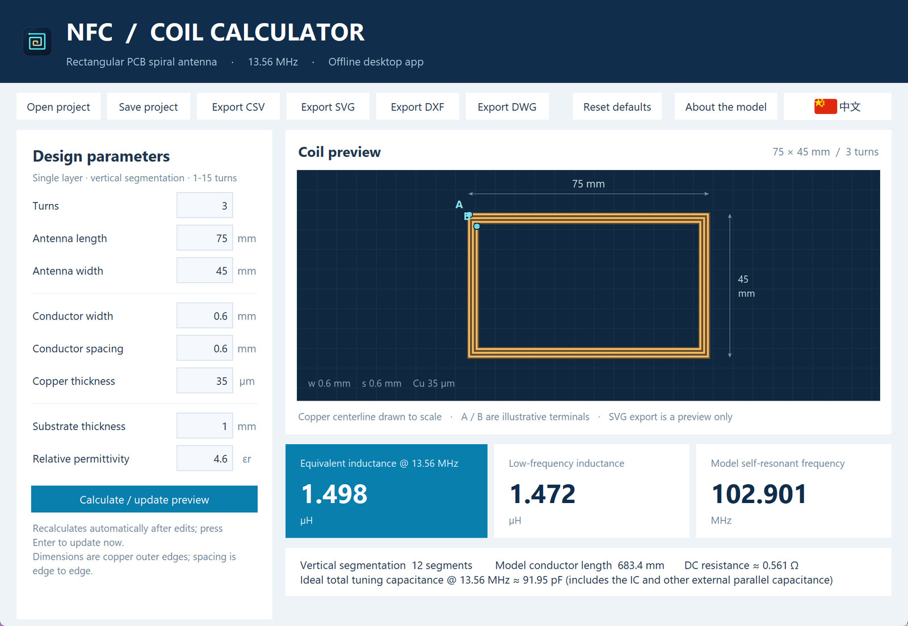
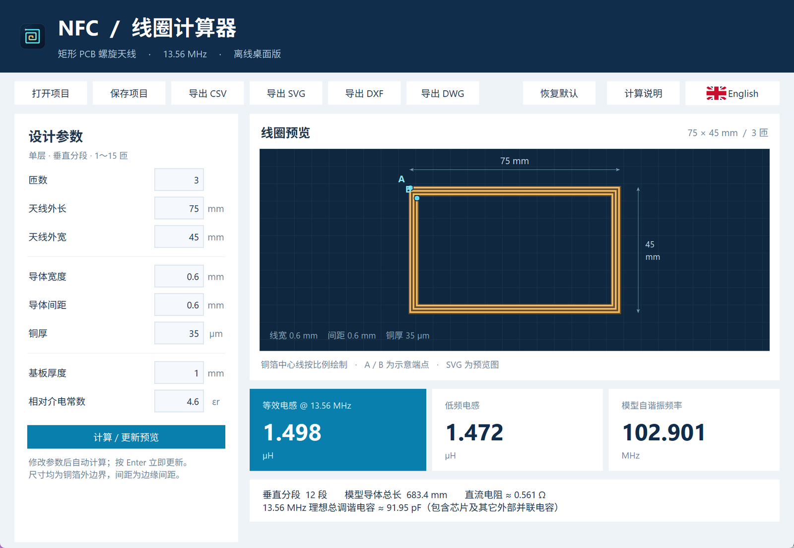

# NFC Coil Calculator

[](https://github.com/89g-dyy/nfc-coil-calculator/actions/workflows/ci.yml)
[](LICENSE)
[](https://www.python.org/)
[](#download)

An offline desktop calculator for **rectangular, single-layer 13.56 MHz NFC PCB spiral antennas**.

It implements the inductances model published by the
[ST eDesignSuite NFC Inductance](https://eds.st.com/antenna/#/) web calculator — segmented Grover
self-inductance, mutual inductance, parasitic capacitance and the 13.56 MHz frequency correction — in
pure Python, and adds practical engineering outputs: a scaled preview, CSV results, JSON projects and
1:1 CAD copper outlines in DXF and DWG.

The default design (3 turns, 75 × 45 mm) yields **1.4982 µH** at 13.56 MHz, matching the 1.5 µH shown
by the source site.



## Features

- **English / 中文 interface** – switch languages with the flag button in the toolbar; the initial
  language follows the Windows UI language.
- **Live calculation** – edit a parameter and the result updates after 0.4 s, or press <kbd>Enter</kbd>.
- **Model outputs** – equivalent inductance @ 13.56 MHz, low-frequency inductance, model
  self-resonant frequency, model conductor length, 20 °C DC resistance estimate and the ideal total
  tuning capacitance.
- **Scaled preview** of the continuous spiral centerline with dimension annotations.
- **JSON projects** for saving and reloading parameter sets (<kbd>Ctrl</kbd>+<kbd>S</kbd> /
  <kbd>Ctrl</kbd>+<kbd>O</kbd>).
- **CSV export** with parameters, results and per-segment detail (UTF-8 BOM, opens directly in Excel).
- **SVG preview** of the coil shape.
- **DXF and DWG export** of a closed, square-ended copper outline at **1:1 in millimetres**, plus a
  hidden centerline and reference rectangle for checking the layout.
- **Fully offline** – no runtime network access and no third-party Python dependencies.

## Download

Prebuilt Windows x64 builds (a single executable containing Python, Tcl/Tk and the offline DWG
converter) are attached to [Releases](https://github.com/89g-dyy/nfc-coil-calculator/releases).

## Run from source

Requires Python 3.10 or newer with Tkinter, which the official Windows installers include.

```powershell
git clone https://github.com/89g-dyy/nfc-coil-calculator.git
cd nfc-coil-calculator
python -m pip install -e .
python -m nfc_coil_calculator
```

On Windows you can also double-click `run.bat`, which runs the package from `src` without installing.

If Tkinter is missing, install the Tcl/Tk component through the Python installer's *Modify* or
*Repair* option.

## Usage

1. Set turns, antenna outer length and width, conductor width and spacing, copper thickness, substrate
   thickness and relative permittivity in the left panel.
2. Read the three headline figures and the detail line on the right.
3. Use the toolbar to save a project or export CSV, SVG, DXF or DWG.
4. Use the flag button at the top right to switch between English and Chinese.



| Parameter | Unit | Default | Allowed | Notes |
| --- | --- | --- | --- | --- |
| Turns | – | 3 | 1–15 | Integer |
| Antenna length | mm | 75 | – | Outer copper edge |
| Antenna width | mm | 45 | – | Outer copper edge |
| Conductor width | mm | 0.6 | 0.15–6 | Copper trace width |
| Conductor spacing | mm | 0.6 | 0.15–2 | Edge-to-edge gap |
| Copper thickness | µm | 35 | > 0.1 | Used by the parasitic capacitance model |
| Substrate thickness | mm | 1 | > 0.1 | Stored but unused, exactly like the source formula |
| Relative permittivity εr | – | 4.6 | 2–6 | Substrate dielectric constant |

| Result | Unit | Meaning |
| --- | --- | --- |
| Equivalent inductance @ 13.56 MHz | µH | Low-frequency inductance corrected for the model self-resonance |
| Low-frequency inductance | µH | Sum of segment self and mutual inductances |
| Model self-resonant frequency | MHz | First impedance minimum found between 25 MHz and 300 MHz |
| Model conductor length | mm | Sum of the segmented lengths used by the model |
| DC resistance @ 20 °C | Ω | Rough estimate; no skin or proximity effect |
| Ideal total tuning capacitance | pF | Total external parallel capacitance required at 13.56 MHz |

### CAD output

- `COPPER` – closed copper foil outline, visible.
- `CENTERLINE` – zero-width spiral centerline, hidden by default.
- `REFERENCE` – antenna outer boundary rectangle, hidden by default.

The origin is at the lower-left corner of the antenna, Y points up, and the outline width and height
equal the entered outer dimensions. Corners are mitered and both ends are square. Exports contain the
spiral conductor only — no pads, vias or lead-in traces — so add them in your PCB tool and check design
rules before fabrication. DWG files are written as AutoCAD 2000 (AC1015) binary by the bundled
LibreDWG converter.

## Scope and accuracy

Only rectangular, single-layer, vertically segmented coils with 1 to 15 turns are modelled: no circular
spirals, stacked layers, magnetic materials or ground planes. Self-resonance is a model estimate, and
the frequency scan starts at 25 MHz, so lower resonances cannot be resolved. Matching the published
algorithm does not make the result equivalent to an electromagnetic simulation or a measurement.

Keeping the source behaviour means the substrate thickness does not influence the result, the empirical
multi-turn correction factors are preserved, and a design whose scan finds no minimum falls back to the
300 MHz scan limit with a warning. DC resistance ignores skin effect, proximity effect, pads and leads;
the tuning capacitance is the ideal total external value, so subtract the IC and any other parallel
capacitance.

The full formula set, constants and known limits are documented in [docs/ALGORITHM.md](docs/ALGORITHM.md).
Reference values used by the test suite in [tests/data/golden_cases.json](tests/data/golden_cases.json)
were produced from the published script, not from a private ST API.

## Development

```powershell
python -m pip install -e ".[dev]"
python -m pytest
```

`ezdxf` is used only to audit the generated DXF files in the tests; DWG round-trip checks require the
LibreDWG tools (see below) and are skipped automatically when those binaries are absent.

| Path | Contents |
| --- | --- |
| `src/nfc_coil_calculator/coil_engine.py` | Segmented inductance, mutual inductance, capacitance, frequency scan |
| `src/nfc_coil_calculator/two_turn_network.py` | Distributed LC network of the two-turn case |
| `src/nfc_coil_calculator/cad_export.py` | DXF writer, copper outline geometry, offline DWG conversion |
| `src/nfc_coil_calculator/exports.py` | JSON projects, CSV results, SVG preview |
| `src/nfc_coil_calculator/app.py` | Tkinter interface, layout scaling and language switch |
| `src/nfc_coil_calculator/i18n.py` | English and Chinese interface strings |
| `src/nfc_coil_calculator/cli.py` | Command line entry point and packaging self-check |
| `scripts/` | Icon generation, LibreDWG download, PyInstaller build, release packaging |
| `docs/` | Algorithm notes, build instructions, third-party notices |

## Build the Windows executable

```powershell
python -m pip install -e ".[build]"
python scripts/download_libredwg.py
python scripts/build_exe.py
```

See [docs/BUILD.md](docs/BUILD.md) for the pinned LibreDWG release, hashes and the verification steps,
including the packaged `--self-check` mode.

## License

Released under the [MIT License](LICENSE). The optional DWG conversion calls the GPL-3.0-or-later
LibreDWG command line tools, which are **not** part of this repository and are not linked into the
source; see [docs/THIRD_PARTY_NOTICES.md](docs/THIRD_PARTY_NOTICES.md) for redistribution requirements.

This is an independent implementation. It is not ST software and is not endorsed by
STMicroelectronics; the published formulas are cited to document where the model comes from.
